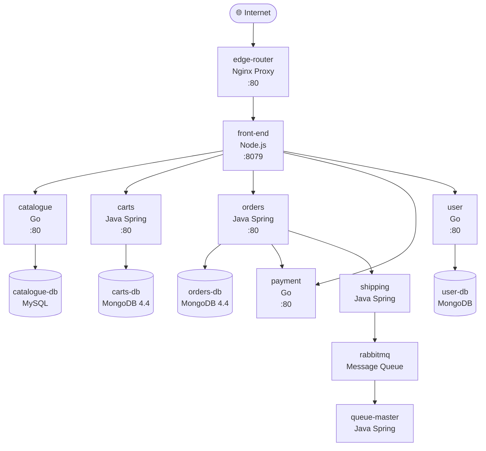

# 🧦 Docker Swarm Microservices — Sock Shop

> A production-grade e-commerce microservices application used for **Docker Swarm training**. Each service is independently deployable, written in a different language, and communicates through REST APIs and message queues.

## 🏗️ System Architecture



## 📦 Services Overview

| # | Service | Language | Database | Port | Description |
|---|---------|----------|----------|------|-------------|
| 1 | [front-end](docs/microservices/01-front-end.md) | Node.js | — | 8079 | Main web UI — single entry point for users |
| 2 | [catalogue](docs/microservices/02-catalogue.md) | Go | MySQL | 80 | Product listing — socks with prices and descriptions |
| 3 | [carts](docs/microservices/03-carts.md) | Java Spring | MongoDB | 80 | Shopping cart — add/remove items |
| 4 | [orders](docs/microservices/04-orders.md) | Java Spring | MongoDB | 80 | Order processing — calls payment + shipping |
| 5 | [payment](docs/microservices/05-payment.md) | Go | — | 80 | Payment authorisation service |
| 6 | [shipping](docs/microservices/06-shipping.md) | Java Spring | RabbitMQ | 80 | Dispatch jobs to message queue |
| 7 | [user](docs/microservices/07-user.md) | Go | MongoDB | 80 | User accounts, login, registration |
| 8 | [queue-master](docs/microservices/08-queue-master.md) | Java Spring | — | — | Reads shipping queue and processes jobs |
| 9 | [rabbitmq](docs/microservices/09-rabbitmq.md) | — | — | 5672 | Message broker between shipping and queue-master |
| 10 | [edge-router](docs/microservices/10-edge-router.md) | Nginx | — | 80 | Reverse proxy — single ingress point |
| 11 | catalogue-db | MySQL | — | 3306 | Product data storage |
| 12 | carts-db | MongoDB 4.4 | — | 27017 | Cart data storage |
| 13 | orders-db | MongoDB 4.4 | — | 27017 | Order history storage |
| 14 | user-db | MongoDB | — | 27017 | User data storage |
| 15 | user-sim | Python | — | — | Load test simulator |

## 🚀 Quick Deploy on Docker Swarm

```bash
# Clone this repository
git clone https://github.com/anujpal-personal-projects/docker-swarm-microservices.git
cd docker-swarm-microservices

# Deploy on your Swarm cluster
docker stack deploy -c docker-compose.yml sockshop

# Watch all 15 services come up
watch docker stack services sockshop

# Access the application
open http://<manager-node-ip>:80
```

> ✅ This `docker-compose.yml` already includes all fixes for RHEL 9 / modern kernels — `mongo:4.4` upgraded and `read_only: true` removed from all services.

## 📂 Repository Structure

```
docker-swarm-microservices/
├── README.md
├── docker-compose.yml
└── docs/
    ├── architecture.md
    ├── microservices/
    │   ├── 01-front-end.md
    │   ├── 02-catalogue.md
    │   ├── 03-carts.md
    │   ├── 04-orders.md
    │   ├── 05-payment.md
    │   ├── 06-shipping.md
    │   ├── 07-user.md
    │   ├── 08-queue-master.md
    │   ├── 09-rabbitmq.md
    │   └── 10-edge-router.md
    └── deployment/
        ├── deploy-swarm.md
        └── troubleshooting.md
```

## 🔗 Resources

- [Docker Swarm Training Portal](https://docker-swarm-workshop.netlify.app)
- [Original Sock Shop by Weaveworks](https://github.com/microservices-demo/microservices-demo)
- [Docker Swarm Documentation](https://docs.docker.com/engine/swarm/)
