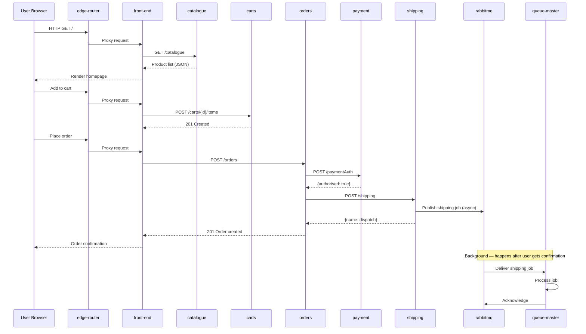

# System Architecture — Sock Shop Microservices

## Overview

Sock Shop is a 15-service e-commerce application where each service owns its own database, is independently deployable, and communicates only through well-defined APIs. No service shares a database with another — this is the **Database Per Service** pattern, the core principle of microservices.

## Full Request Flow — Placing an Order



## Communication Patterns

### Synchronous (REST over HTTP)
Most services communicate synchronously — the caller waits for a response:

```
front-end → catalogue   (GET /catalogue)
front-end → carts       (POST /carts/{id}/items)
orders    → payment     (POST /paymentAuth)
orders    → shipping    (POST /shipping)
```

### Asynchronous (Message Queue)
Shipping uses async communication — the caller does NOT wait:

```
shipping  → rabbitmq    (AMQP Publish)
rabbitmq  → queue-master (AMQP Deliver)
```

## Database Per Service Pattern

| Service | Database | Why this choice |
|---------|----------|----------------|
| catalogue | MySQL | Relational product data with categories and tags |
| carts | MongoDB 4.4 | Flexible cart items — schema varies per user |
| orders | MongoDB 4.4 | Order history with nested line items |
| user | MongoDB | User profiles with embedded address objects |
| shipping | RabbitMQ | Async job queue — fire and forget |

## Fault Isolation Demo

| If you kill... | What breaks | What still works |
|---------------|-------------|------------------|
| payment | Checkout only | Browse, login, cart, order history |
| catalogue | Product listing | Login, cart, existing orders |
| shipping | Order dispatch | Browse, login, cart, payment |
| user | Login/register | Browse catalogue (if already logged in) |
| queue-master | Background dispatch | Everything — jobs queue up in RabbitMQ |
