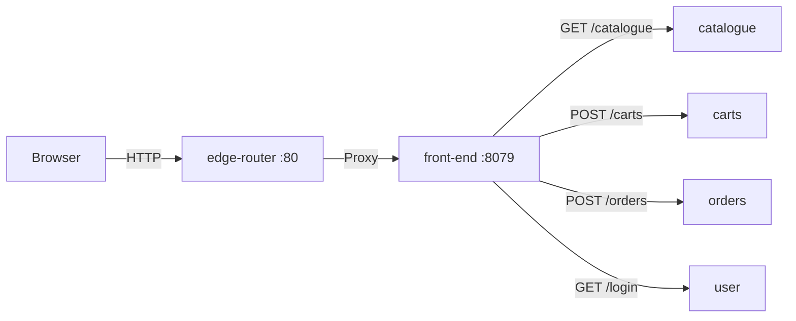

# Service 01 — front-end

## What is it?

The front-end is the main web UI for the Sock Shop. It is a **Node.js / Express** application that serves HTML pages to users' browsers and acts as an **API aggregator** — it calls all backend microservices (catalogue, carts, orders, payment, user) and combines their responses into a single rendered web page.

It is the only service users interact with directly (via the edge-router). No backend service is ever called directly from the browser — all calls go through the front-end.

## Technical Details

| Property | Value |
|----------|-------|
| Language | Node.js (JavaScript) |
| Framework | Express.js |
| Database | None — fully stateless |
| Internal Port | 8079 |
| Docker Image | `weaveworksdemos/front-end:0.3.12` |

## Communication Diagram



## Key Concepts

- **API Aggregation**: The front-end calls multiple services and merges their data into one HTML response. The browser never talks to individual microservices.
- **Stateless design**: No session data stored. Any replica can handle any request — safe to scale to N replicas.
- **Service discovery by DNS**: Calls `http://catalogue/catalogue` not an IP. Docker Swarm's internal DNS resolves `catalogue` to the running container automatically.

## Hands-On Practice

```bash
# Scale to 3 replicas — all share the same backends
docker service scale sockshop_front-end=3

# See which node each replica is on
docker service ps sockshop_front-end

# Watch live logs
docker service logs sockshop_front-end -f --tail 20

# Kill front-end — entire UI goes down, but all APIs still work internally
docker service scale sockshop_front-end=0
docker service scale sockshop_front-end=1
```
