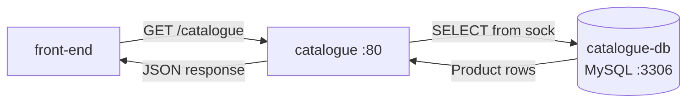

# Service 02 — catalogue

## What is it?

The catalogue service is a **Go** microservice that manages the product inventory — all the socks available in the shop. It exposes a REST API that the front-end queries to get product listings, individual sock details, and tag/category filters. It uses a **MySQL** database with structured relational tables.

## Technical Details

| Property | Value |
|----------|-------|
| Language | Go |
| Framework | Go standard library + gorilla/mux |
| Database | MySQL (catalogue-db) |
| Internal Port | 80 |
| Docker Image | `weaveworksdemos/catalogue:0.3.5` |
| DB Image | `weaveworksdemos/catalogue-db:0.3.0` |

## API Endpoints

| Method | Endpoint | Description |
|--------|----------|-------------|
| GET | `/catalogue` | List all socks (supports `page`, `size`, `tags`) |
| GET | `/catalogue/{id}` | Get one sock by ID |
| GET | `/tags` | List all available categories |
| GET | `/health` | Health check |

## Communication Diagram



## Hands-On Practice

```bash
# Test the API directly
curl http://<manager-ip>/catalogue | python3 -m json.tool

# Filter by tag
curl 'http://<manager-ip>/catalogue?tags=formal'

# Kill catalogue — product listing breaks, login/cart still work
docker service scale sockshop_catalogue=0
docker service scale sockshop_catalogue=1
```
