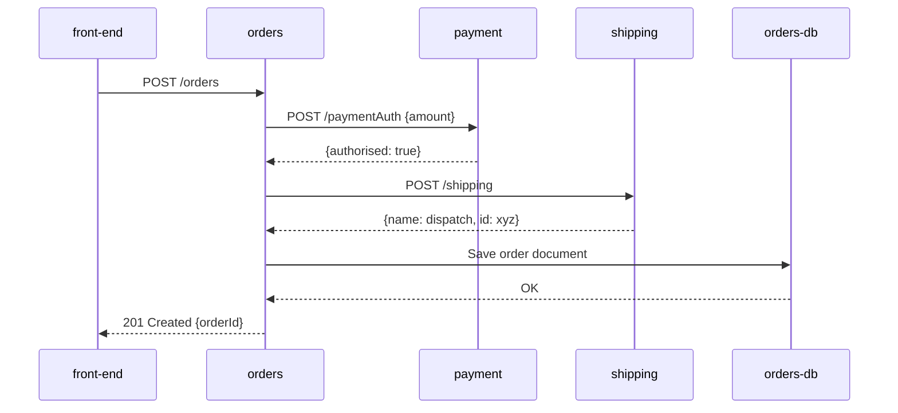

# Service 04 — orders

## What is it?

The orders service is a **Java Spring Boot** microservice that orchestrates the entire checkout process. It coordinates multiple downstream services in sequence:
1. Calls **payment** to authorise the transaction
2. Calls **shipping** to dispatch the order
3. Saves the order record to its own **MongoDB** database
4. Returns confirmation to the front-end

## Technical Details

| Property | Value |
|----------|-------|
| Language | Java |
| Framework | Spring Boot 1.4 |
| Database | MongoDB 4.4 (orders-db) |
| Internal Port | 80 |
| Docker Image | `weaveworksdemos/orders:0.4.7` |

## Checkout Orchestration Flow



## Hands-On Practice

```bash
# Kill payment — checkout fails, everything else works
docker service scale sockshop_payment=0
# Try placing an order in the browser — it fails with payment error
docker service scale sockshop_payment=1

# View order service logs
docker service logs sockshop_orders --tail 30
```
