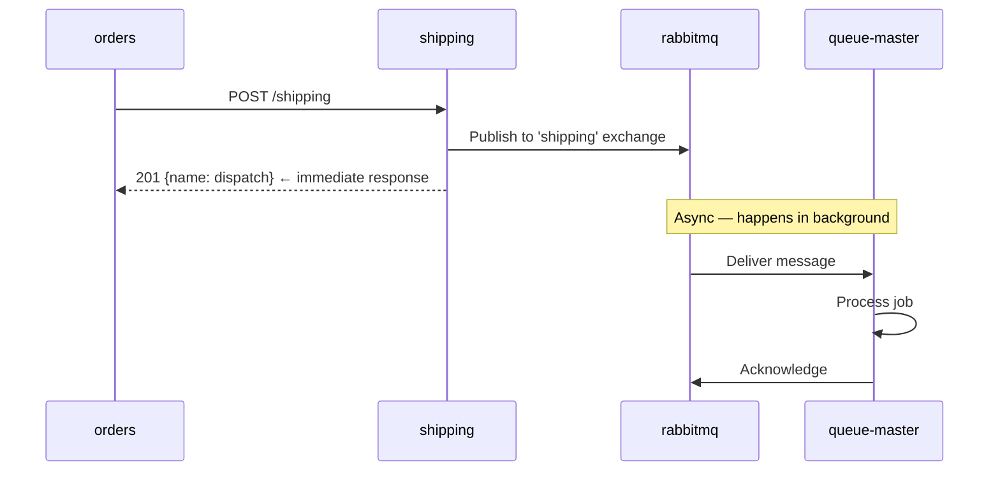

# Service 06 — shipping

## What is it?

The shipping service is a **Java Spring Boot** microservice responsible for dispatching orders. After a successful payment, the orders service calls shipping which creates a job and publishes it to **RabbitMQ**. The actual processing happens asynchronously in **queue-master**.

This is the application's only example of **async, event-driven communication**.

## Technical Details

| Property | Value |
|----------|-------|
| Language | Java |
| Framework | Spring Boot + Spring AMQP |
| Message Queue | RabbitMQ |
| Internal Port | 80 |
| Docker Image | `weaveworksdemos/shipping:0.4.8` |

## Async Communication Flow



## Sync vs Async Comparison

| | Synchronous (REST) | Asynchronous (Queue) |
|--|-------------------|---------------------|
| Example | orders → payment | shipping → queue-master |
| Caller waits? | Yes | No |
| Tight coupling? | Yes | No |
| Use when | Need immediate result | Background processing OK |

## Hands-On Practice

```bash
# Watch shipping logs during a checkout
docker service logs sockshop_shipping -f --tail 20

# Kill queue-master — shipping still succeeds (jobs queue in RabbitMQ)
docker service scale sockshop_queue-master=0
# Place an order — succeeds
docker service scale sockshop_queue-master=1
# It wakes up and processes queued jobs
```
