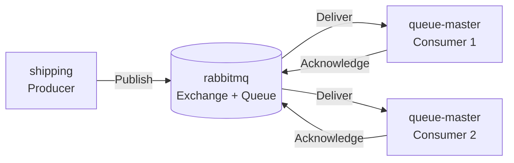

# Service 08 — queue-master

## What is it?

The queue-master is a **Java Spring Boot** microservice that acts as a **consumer** for the RabbitMQ message queue. It continuously listens to the `shipping` queue and processes every shipping job published by the shipping service.

## Technical Details

| Property | Value |
|----------|-------|
| Language | Java |
| Framework | Spring Boot + Spring AMQP |
| Queue | RabbitMQ |
| Public Port | None — queue consumer only |
| Docker Image | `weaveworksdemos/queue-master:0.3.1` |

## Message Processing Flow



## Key Concepts

- **Pure consumer**: queue-master never receives HTTP requests — it only reads from the queue.
- **Competing consumers**: Scale to 3 replicas and they share the work — each message goes to exactly one consumer.
- **At-least-once delivery**: If queue-master crashes mid-processing, RabbitMQ requeues the message and redelivers on restart.

## Hands-On Practice

```bash
# Watch queue-master process jobs in real time
docker service logs sockshop_queue-master -f
# Place an order in the browser — watch the log

# Scale to 3 consumers — they share the queue
docker service scale sockshop_queue-master=3

# Kill queue-master, place 3 orders, restart — it processes all 3
docker service scale sockshop_queue-master=0
# Place 3 orders in browser
docker service scale sockshop_queue-master=1
# Watch it process all 3 queued jobs
```
