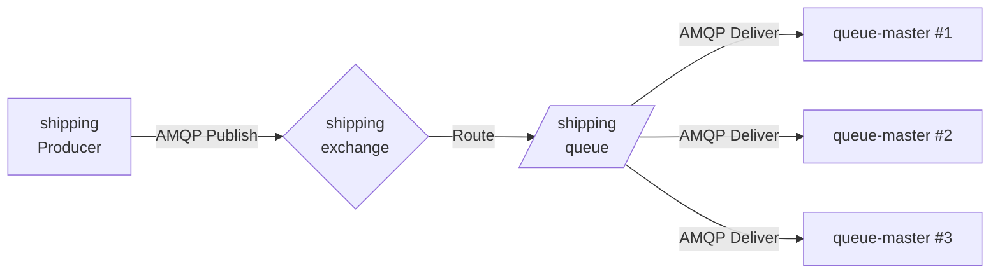

# Service 09 — rabbitmq

## What is it?

**RabbitMQ** is an open-source message broker that receives messages from producers (shipping service) and delivers them to consumers (queue-master). It implements the **AMQP** (Advanced Message Queuing Protocol) standard.

## Technical Details

| Property | Value |
|----------|-------|
| Type | Message Broker |
| Protocol | AMQP 0-9-1 |
| Ports | 5672 (AMQP), 15672 (Management UI) |
| Docker Image | `rabbitmq:3.6.8` |

## Producer / Consumer Architecture



## Core Concepts

| Concept | Explanation |
|---------|-------------|
| **Exchange** | Messages published here — routes to correct queue based on rules |
| **Queue** | Buffer that holds messages until a consumer is ready |
| **Acknowledgement** | Consumer sends `ack` after processing — only then message is deleted |
| **Competing consumers** | Multiple consumers on one queue — each message goes to exactly ONE |
| **Durability** | Messages survive RabbitMQ restart if marked persistent |

## Hands-On Practice

```bash
# Check RabbitMQ is running
docker service ps sockshop_rabbitmq

# To enable the Management UI, add to docker-compose.yml under rabbitmq:
#   ports:
#     - '15672:15672'
# Then: http://<manager-ip>:15672  (login: guest / guest)
```
