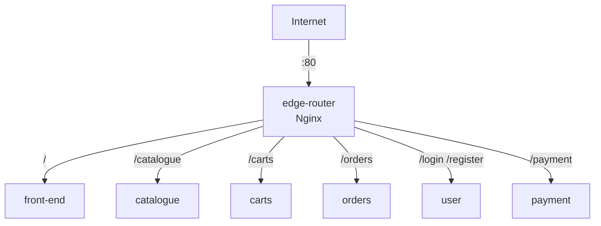

# Service 10 — edge-router

## What is it?

The edge-router is an **Nginx** reverse proxy that acts as the single entry point for all external traffic. Users only connect to port 80 — they never talk directly to the front-end, catalogue, or any other service. This is the **API Gateway pattern**.

## Technical Details

| Property | Value |
|----------|-------|
| Type | Nginx reverse proxy |
| External Ports | 80 (HTTP), 8080 (admin) |
| Docker Image | `weaveworksdemos/edge-router:0.1.1` |

## Routing Rules

| URL Path | Forwarded to | Description |
|----------|-------------|-------------|
| `/` | front-end:8079 | Main web UI |
| `/catalogue` | catalogue:80 | Product API |
| `/carts` | carts:80 | Cart API |
| `/orders` | orders:80 | Orders API |
| `/login /register` | user:80 | Auth endpoints |
| `/payment` | payment:80 | Payment API |
| `/shipping` | shipping:80 | Shipping API |

## Traffic Flow Diagram



## Key Concepts

- **Single entry point**: Clients never need to know internal service ports.
- **SSL termination**: In production, edge-router handles HTTPS — internal services use plain HTTP.
- **Security boundary**: Only the edge-router has a public port. All other services are on the internal overlay network.

## Hands-On Practice

```bash
# Test routing through the edge-router
curl http://<manager-ip>/catalogue
curl http://<manager-ip>/tags
curl -u user:password http://<manager-ip>/login

# View access logs — see every request routed
docker service logs sockshop_edge-router -f

# Scale for HA
docker service scale sockshop_edge-router=2
```
